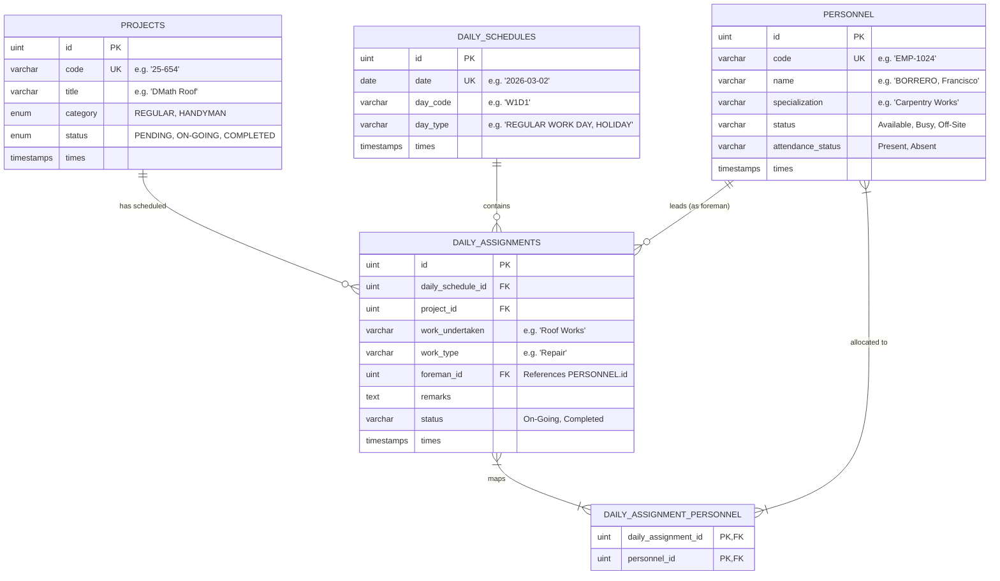

# System Design: Excel to Web Migration
This document outlines the database schema (MySQL), business logic rules, and modern Laravel 13 API endpoints required to migrate the project planning spreadsheet (`2026 03 March V2.xlsx`) into a relational database and web-based application.

---

## 1. Relational Database Schema Design (MySQL)

To migrate the multi-tab spreadsheet format, we decompose the workbook into 5 relational tables:



---

## 2. Business Logic Specifications

Migrating from the multi-week grid of the Excel workbook introduces specific business rules:

### A. The Project Allocation Matrix (The Daily Worksheet)
* **One Worker Per Project per Day**: Typically, an employee can only be active on one project row per day. 
  * *Constraint Rule*: When attempting to assign personnel to a project, validation must check if they are already linked to a different `daily_assignments` record on the same `daily_schedule_id`. If so, reject the request or trigger an override confirmation.
* **Foreman Assignment**: Each project row for a day has an assigned Foreman. The Foreman must be a valid personnel member, usually chosen from senior staff.
* **Workers Count (Auto-calculated)**: In the sheet, column `Count` represents the sum of checked employees. In the database, this is computed dynamically as:
  ```sql
  SELECT COUNT(*) FROM daily_assignment_personnel WHERE daily_assignment_id = :id;
  ```

### B. Monthly Schedule Grid Generation (The Summary Sheet)
* In the Excel, the `SUMMARY` sheet displays checkmarks (`True`/`False`) for each day (`W1D1` to `W5D5`) indicating if a project had work on that day.
* *Database Translation*: Rather than maintaining a static summary table, we query this dynamically using a pivot strategy:
  ```sql
  SELECT 
      p.code, 
      p.title,
      s.day_code,
      IF(a.id IS NOT NULL, true, false) as has_work
  FROM projects p
  CROSS JOIN daily_schedules s
  LEFT JOIN daily_assignments a ON a.project_id = p.id AND a.daily_schedule_id = s.id
  WHERE s.date BETWEEN :start_date AND :end_date;
  ```

### C. Day Type Configurations
* Days can be flagged with types (from the `Reference` sheet: `REGULAR WORK DAY`, `HOLIDAY`, `ONE DAY OPERATION`, `EMERGENCY RESPONSE`, `HALFDAY WORK`).
* *Holiday Rule*: If `day_type` is updated to `'HOLIDAY'`, the system triggers a client prompt warning the user that editing assignments on holidays is restricted, and any pre-existing assignments for that day are visually greyed out but preserved.

---

## 3. Updated Laravel 13 Route Registry (`routes/api.php`)

Using modern Laravel 13 controllers and routing features, the following API endpoints cover both the existing personnel/work-order services and the new daily schedule matrix:

### A. Projects & Work Orders
* **`GET /api/projects`**  
  *Controller Action:* `ProjectController@index`  
  *Description:* Fetch all projects including their overall statuses.
* **`POST /api/projects`**  
  *Controller Action:* `ProjectController@store`  
  *Description:* Create a new project registry (equivalent to adding a project row on the spreadsheet).
* **`DELETE /api/projects/{code}`**  
  *Controller Action:* `ProjectController@destroy`  
  *Description:* Deletes a project and its historical allocations.

### B. Roster & Personnel
* **`GET /api/personnel`**  
  *Controller Action:* `PersonnelController@index`  
  *Description:* List all available staff along with their specializations/roles.
* **`POST /api/personnel`**  
  *Controller Action:* `PersonnelController@store`  
  *Description:* Onboard or update an employee.

### C. Monthly Overview & Analytics
* **`GET /api/schedule/monthly-summary`**  
  *Controller Action:* `ScheduleController@monthlySummary`  
  *Query Parameters:* `?month=2026-03`  
  *Description:* Returns a pivot-style list of projects mapping to 20-25 days showing boolean work indicators for rendering the main grid matrix.

### D. Daily Worksheet Assignments (Daily Grid Sheets `W1D1` -> `W5D5`)
* **`GET /api/schedule/daily/{date}`**  
  *Controller Action:* `ScheduleController@getDailyWorksheet`  
  *Description:* Fetch the worksheet structure for a single date, returning:
    1. Day metadata (e.g. Code: `W1D1`, Type: `REGULAR WORK DAY`).
    2. Active projects scheduled on this day.
    3. Grid mappings indicating which personnel are assigned to which project.
* **`POST /api/schedule/daily/{date}/sync`**  
  *Controller Action:* `ScheduleController@syncDailyWorksheet`  
  *Description:* Batch updates the daily projects grid and synchronizes employee assignments.
  *Payload Structure:*
    ```json
    {
      "day_type": "REGULAR WORK DAY",
      "assignments": [
        {
          "project_code": "25-654",
          "work_undertaken": "Roof Works",
          "work_type": "Repair",
          "status": "On-Going",
          "remarks": "Repairing leak",
          "foreman_code": "EMP-9102",
          "assigned_personnel_codes": [
            "EMP-1025",
            "EMP-1031"
          ]
        }
      ]
    }
    ```
* **`POST /api/schedule/daily/{date}/toggle-assignment`**  
  *Controller Action:* `ScheduleController@toggleAssignment`  
  *Description:* Single-cell toggling on the grid sheet (checkbox checked/unchecked). Assigns or deallocates a specific worker to/from a project on that day.
  *Payload Structure:*
    ```json
    {
      "project_code": "25-654",
      "personnel_code": "EMP-1025",
      "assign": true
    }
    ```
